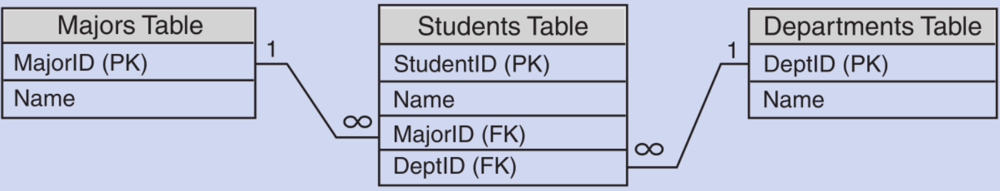

# Objectives

- Become familiar with basic sql database commands.
- Learn specifics of creating and accessing database systems using Python
  SQLite module.
- Become more familiar with relational database definitions and applications.
- Learn how to create basic CRUD application to create and maintain basic
  database information.

# Description

This assignment consists of 4 questions in which you will be creating
a basic relational database and implementing basic applications to
maintain the data in the database. You will be creating several
(similar) basic terminal based CRUD applications to update and maintain
the various tables of the relational database.

## Assignment Prerequisites and Setup

Before performing any assignment in this class, you need to have
the following tasks already completed.

1. You need to have `git` tools installed on your system so that you
   can successfully clone repositories and create commits.
2. You need to have a GitHub account created.
   - You need to have successfully created a ssh key so that you can
     authenticate with and push commits back to git.
3. You need a working Python 3 distribution installed on the system you
   will work on these assignments with, that you can run Python scripts
   and the Python IDLE interface within.

See our class 
[Getting Started with Python and Git for Class Assignments](https://github.com/etamu-class/python-git)
for links on setting up these needed development environment tools and configuration.


# Assignment Questions

Start by cloning the assignment repository that was created for
you when you accepted the assignment.  There are 3 mostly empty
Python script files in the top level of this assignment named
`q01.py` through `q03.py`.

You should answer each of the following questions by writing appropriate
Python code to solve the stated task.  Once you are satisfied with
your answer, you should create a commit and push it back to your
GitHub repository for grading.  In general you should do each
question as a separate commit 
(see [Git Best Practices](https://gist.github.com/luismts/495d982e8c5b1a0ced4a57cf3d93cf60)).

Each commit you push to GitHub will create a release that will be
graded.  Look at the `Releases` on the right hand side of your `Code`
page to see a summary of your grade results.  Also the instructor
will give feedback for all assignments in your `Feedback` Pull request.
See the `Feedback` pull request listed on GitHub on the `Pull requests`
tab.

You can and should test your code locally before creating commits
and submitting it to GitHub.  As mentioned, since you are now writing
functions for your assignments, we are now using the `pytest` unit
testing module in your autograder and to run tests against your work.
So for example, to run the tests for question 01, from the command line you
can do:

```bash
$ python3 -m pytest -v -s test/test_q01.py
=================================== test session starts ====================================
platform linux -- Python 3.14.10, pytest-9.2.0, pluggy-1.7.0 -- /opt/base/bin/python3
cachedir: .pytest_cache
rootdir: /workspaces/assg08-solution
collected 4 items                                                                                

test/test_q01.py::test_calculate_assessment PASSED
test/test_q01.py::test_calculate_property_tax PASSED
test/test_q01.py::test_mainloop_exists PASSED
test/test_q01.py::test_assess_callback_exists PASSED

==================================== 4 passed in 0.15s =====================================

```

There should be tests for each question in the `test` subdirectory,
named `test_q01.py`, `test_q02.py`, etc. for our class assignments.
These will be (some of) the same `pytest` tests that are run by the autograder
when you submit your work.

For the applications that your write in questions for an assignment,
we are also still using the simple input / output diff comparison to
test.  These are invoked as part of the `pytest` tests of these questions.
But as usual, when you are writing the applications, you can look for the
expected output in the `test/data` subdirectory, to see exactly
what your prompts and output should be formatted to look like in order
to pass your tests.  For example, if you run the tests for a question
03 application (and you have them passing), you should see:

```bash
$ python3 -m pytest -v -s test/test_q02.py
============================= test session starts ==============================
platform linux -- Python 3.14.6, pytest-9.1.1, pluggy-1.6.0 -- /opt/base/bin/python3
cachedir: .pytest_cache
rootdir: /workspaces/assg03-solution
collected 5 items                                                                                                                                              

test/test_q03.py::test_small_loan PASSED
test/test_q03.py::test_medium_loan PASSED
test/test_q03.py::test_large_loan PASSED
test/test_q03.py::test_zero_interest PASSED
test/test_q03.py::test_q03_application 
Question <q03_application> Test 01:  PASSED 
Question <q03_application> Test 02:  PASSED 
Question <q03_application> Test 03:  PASSED 
Question <q03_application> Test 04:  PASSED 

 =========================================================================== 
 All attempted question tests passed  (004 passed of 004 tests attempted)
PASSED

============================== 5 passed in 0.10s ==============================

```

Here the `q03_application` tests are being invoked by the `pytest` module,
but you can still run these by hand if you wish:

```bash
$ python3 test/test-question.py -c q03_application.py

Question <q03_application> Test 01:  PASSED 
Question <q03_application> Test 02:  PASSED 
Question <q03_application> Test 03:  PASSED 
Question <q03_application> Test 04:  PASSED 

 =========================================================================== 
 All attempted question tests passed  (004 passed of 004 tests attempted)
```


## Question 1: Student Information Relational Database Application, Database Creation (10 points)

In this assignment, you will create a database that holds the following information
about students at a college:

- The student's name
- The student's major
- The department in which the student is enrolled

The database should have the following tables:

**Majors** table:

| Column Name | Type                |
| ----------- | ------------------- |
| MajorID     | INTEGER PRIMARY KEY |
| Name        | TEXT                |

**Departments** table:

| Column Name | Type                |
| ----------- | ------------------- |
| DeptID      | INTEGER PRIMARY KEY |
| Name        | TEXT                |

**Students** table:

| Column Name | Type                                        |
| ----------- | ------------------------------------------- |
| StudentID   | INTEGER PRIMARY KEY                         |
| Name        | TEXT                                        |
| MajorID     | INTEGER (Foreign key to Majors.MajorID)     |
| DeptID      | INTEGER (Foreign key to Departments.DeptID) |

The entity relationship diagram for this database design is show in
Figure 1.



For this first question / task, write the following functions in the `q01.py` file:

- A function named `setup_student_info_database()`. This function should create
  all 3 tables, with the shown types and foreign key relationships. This
  function should be idempotent, e.g. if a table is missing it will be created,
  but if the table already exists (possibly with data) it will not delete the
  data.  In other words, this function can be called at anytime, and it will
  create missing tables, but not remove or effect existing tables and data.
- A function named `clear_student_info_database()`.  This function should
  remove all data from all tables, drop the tables, and then recreate the
  database.  This function should reuse the `setup_student_info_database()`
  instead of repeating code to perform table and relationship creation.

These functions both take the file name of the database to be created / cleared.
The unit tests for this first task will check that the expected tables are
created in the asked for database file, and that all names and relationships
are present and correct.

Once you are done with the question 01 functions, make sure you make a commit
and push your work to your Github repository for evaluation.

## Question 2: Majors Table CRUD Application (10 points)

The next 3 tasks will be similar and a bit repetitive.  But we need
to have separate applications so that we can create, read, update and
delete information from each of the 3 tables in the student info
database.

Your implementation of basic CRUD should be similar to our textbook
example CRUD database application.  Create a CRUD application to
maintain the Majors table in a file named `majors_crud.py`

Using Program 14-15 from our textbook as a template, modify the application
to work for the Majors table in a `student_info.db` database file.
The following slight modifications should be made.

- Define a global string constant called `STUDENT_DB_FILE` that uses a file
  named `test/data/student_info.db`.  This file should be the one that is
  opened for each of the functions that connects to and performs operations
  on the database.  Notice the file needs to be relative to the top level of
  your assignment directory.
- In the `main()` function, before displaying the menu, import and call your
  idempotent `setup_student_info_database()` function, to ensure that
  the needed database tables and relationships are correctly set for your
  crud application.
- I have modified the expected applications (for this and the next ones)
  to add in a 5th menu item choice.
  - Add in a DISPLAY=5 choice to list of items, and move the EXIT to be
    item 6
  - Add in a menu item 5 offering to "Display all Majors"
  - Add in a `display()` function and a `display_all_items()` function that will display
    all of the Majors currently in the database.
  - Also I think the application is easier to use if `display_all_items()` is called instead of
    `read()` when you want to update or delete a Major.  Change the calls in those functions to
    simply display all of the items in the Major table when selecting a Major to update or delete.

The tests for this and the following questions are application tests, that
run your application to create, read, update and delete items from the
Majors table.  You will need to ensure that your application output matches
the expected output given in the tests.

## Question 3: Departments Table CRUD Application (10 points)

Do the same but for the `Departments` table. You should do this in a file named
`departments_crud.py`. You should be able to copy most of the code from the
`Majors` table application here, just modifying the prompt names and the table
and column names needed in this application. Normally the repetition here
between these two applications is a bad code smell, and we would want to
refactor. But for this assignment we just want a basic working set of 3 separate
applications to maintain the 3 tables in a simple manner. You are done with this
application once you can pass the question 03 application tests in the
assignment. Make sure that you are making and pushing a commit of your work for
each question / application once you finish it.

## Question 4: Students Table CRUD Application (10 points)

Finally create the CRUD application for the `Students` table in the file named
`students_crud.py`.  Again you will want to start with the previous code
you implemented for the `Majors` and `Departments` CRUD applications.  Though
there are a few more modifications to be made this time:

- For this application, make sure that you enable the foreign key constraint for
  SQLite in your `main()` function, by doing a 
  "cur.execute('PRAGMA foreign_keys=ON)". This call is not persistent, so you need to execute the
  `PRAGMA` before you do insertions or modifications of a student. The
  constraints will be checked by the application tests, e.g. that an exception
  is thrown and handled if you try and create a student with an invalid
  department or major id.
- When creating a student, you will need to prompt for the `DeptID` and `MajorID` keys
  for the department and major that the student is associated with.
- Likewise update your displays to show the name of the department and major.  This 
  will require you to do a retrieval from multiple tables using the foreign keys so you
  can get the readable names of the major and department when you display the student
  information.

Once you are satisfied with your work and can pass the application tests for
question 04 make sure that you commit and push your work to your repository for
evaluation. As a note, the application tests for the Departments and Major
tables are actually run again when the full Students CRUD application is tested
here, so that a major and a department are created and exist in the database
when the student CRUD application is tested.

# Assignment Conclusion / Checklist

Hopefully you have created commits after completing each question and pushed
them successfully to your assignment repository.  Make sure that you
do the following for this and all class assignments.

- Check your autograder results after pushing your commits.  Look
  in your `Feedback` pull request, and in the detailed autograder
  report generated for your release(s) made for each commit.
- You should never close or merge your `Feedback` pull request, as is
  mentioned in the comment.  The instructor will evaluate your assignments,
  and may give you feedback about your code or work.  Check here after
  the assignment is returned for a code review and assignment comments.
- In general this class will ask you to follow and use good Python
  style as specified by the official
  [Python PEP 8 Style guide](https://peps.python.org/pep-0008/).
  You should at least pay attention to
  - All indentation is required to be 4 spaces with no tabs in files.
  - Maximum line lengths should be usually observed, do not generally
    extend code past the 79 character column in a file.
  - Follow the suggestions for breaking long lines in code (e.g. line
    break before binary operators in a long expressions).
  - Prefer single quotes for all string in code for class assignments,
    unless you need a string with a single quote, for example to
    add an apostrophe 's.
  - Follow Pep8 style for whitespace in expressions and statements.  
    For example, usually a single space should go before and after
    all binary operators in expressions.
  - We encourage the use of function annotations in Python code.
- Also in general in this class we will ask you to follow
  [Git Commit Best Practices](https://gist.github.com/luismts/495d982e8c5b1a0ced4a57cf3d93cf60)
- Strive to use 
  [Meaningful Names](https://www.freecodecamp.org/news/how-to-write-better-variable-names/)
  for variables, constants and functions in your code.  You are required
  to follow Pep8 naming guidelines, which means `snake_case` names
  for variables and functions and `SCREAMING_SNAKE_CASE` for 
  constants.  Python style switches to `PascalCase` for 
  class names.

Make sure you are checking review comments and code review given
for your class assignments.  We may start by making suggestions where your
style or practices could be improved.  As the class progresses, some
of these suggestions may become requirements, especially for students who
are repeatedly making the same style or practice error and are not
following feedback to correct a noted issue in future assignments.
Assignments may be left ungraded in some cases for style or practice
issues until corrected, and/or may have points removed or receive
a 0 grade if issues continue after receiving multiple feedback that
are repeatedly ignored and not corrected.

# Additional Information

The following are suggested online materials you may use to help you understand
the tools and topics we have introduced in this assignment.

- [Python PEP 8 Style guide](https://peps.python.org/pep-0008/)
- [Git Commit Best Practices](https://gist.github.com/luismts/495d982e8c5b1a0ced4a57cf3d93cf60)
- [Git Best Practices](https://gist.github.com/pandeiro/1552496)
- [Best Practices to Write Readable and Maintainable Code: Choosing meaningful names](https://dev.to/pacheco/how-do-you-name-things-3jae)
- [How to Write Better Names for your Variables, Functions and Classes](https://www.freecodecamp.org/news/how-to-write-better-variable-names/)